
<b>◢ KENTAVR</b>

Генератор сетів і аналізатор бібліотеки для hard / industrial techno · Windows

<b><a href="https://github.com/Hester1337/KENTAVR-PUBLIC/raw/download/KENTAVR_Setup.exe">⬇ Завантажити для Windows</a></b> · <a href="#english">English</a>

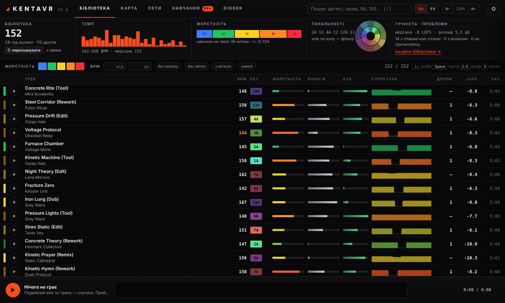

KENTAVR аналізує твою музичну бібліотеку і складає з неї сети: які треки, в якому порядку, де і як зводити. Аудіо він не генерує. Усе працює на твоєму комп'ютері, музика нікуди не завантажується.

## Що вміє

- **Аналіз треків.** Темп і сітка, тональність за Camelot, дропи, фрази по 16/32 такти, інтро й аутро, гучність, вокал, жорсткість, енергія і рух. Сітку, BPM і хот-кю з Serato бере з тегів файлів.
- **Генератор сетів.** Малюєш дугу енергії або береш готову, задаєш довжину, BPM і тональність. Отримуєш до трьох варіантів сету з оцінкою кожного переходу. Треки можна закріпити, замінити, а решту перегенерувати.
- **Переходи.** Для кожної пари треків: тип (LONG BLEND, BASS SWAP, DROP SLAM, ECHO OUT, HARD CUT), такти виходу і входу, план мікшера по тактах. Перехід можна одразу послухати.
- **Карта звучання.** Бібліотека, розкладена за схожістю. Виділяєш ділянку і генеруєш сет з цих треків.
- **Навчання.** Кольори жорсткості (можна імпортувати з Serato), правки дропів, оцінки переходів, записи чужих міксів. Коли програма не впевнена, вона питає.
- **Digger.** Профіль SoundCloud, плейлист чи пошук: треки аналізуються так само, як твої, і видно, що пасує до твоєї бібліотеки. Аудіо після аналізу видаляється.
- **Експорт.** Крейт у Serato, Rekordbox XML з хот-кю на дропах, M3U8, CSV, трекліст, нумерація треків у тегах.
- **Інтерфейс** українською, англійською, чеською та російською, масштаб 90–150%.

| | |
|---|---|
| 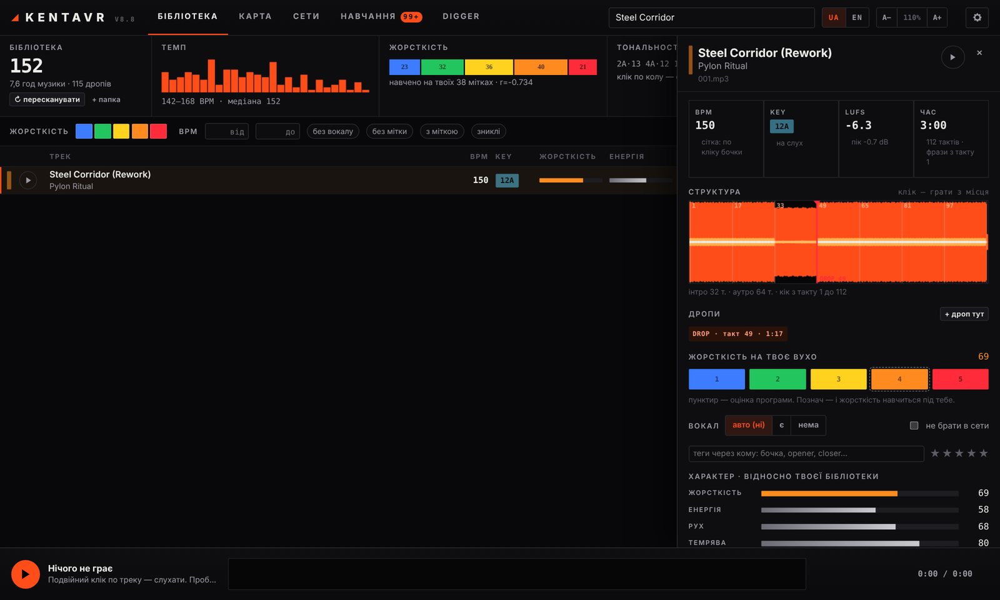 |  |
| 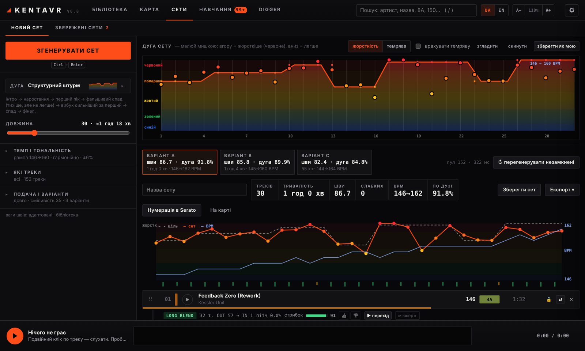 | 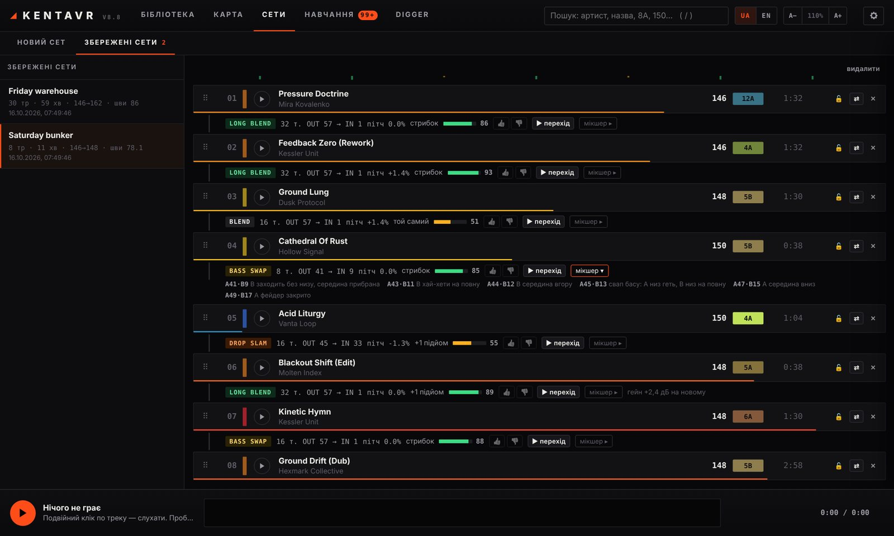 |

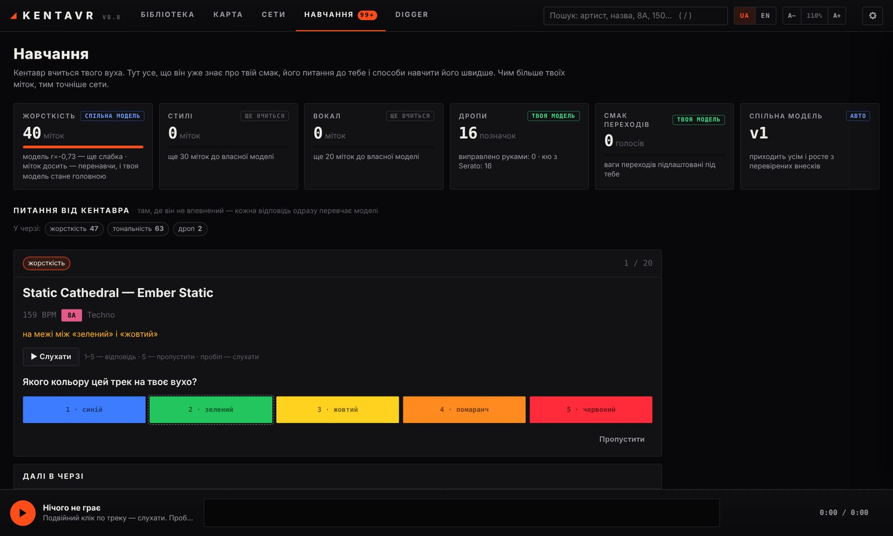

## Встановлення

1. Завантаж [`KENTAVR_Setup.exe`](https://github.com/Hester1337/KENTAVR-PUBLIC/raw/download/KENTAVR_Setup.exe) і запусти.
2. Обери **Повну** (з нейромережами для точної сітки, AI-вуха і вокалу) або **Легку** версію. Права адміністратора не потрібні.
3. Ярлик з'явиться на робочому столі. Нові версії ставляться кнопкою **«Оновити»** у програмі, бібліотека й налаштування лишаються.

Якщо Windows покаже «Windows захистив ваш ПК», натисни «Докладніше» → «Усе одно запустити». Інсталятор поки не має цифрового підпису.

**Потрібно:** Windows 10 або 11 (64-біт), інтернет під час встановлення. Повна версія: ~3.5 ГБ на диску, від 8 ГБ оперативної пам'яті. Легка: ~1.2 ГБ. Відеокарта NVIDIA необов'язкова, з нею аналіз швидший.

## Приватність

- Музика, назви файлів і шляхи не покидають твій комп'ютер. Реєстрація не потрібна.
- При першому запуску програма питає дозволу надсилати анонімну статистику і мітки для спільної моделі (числа аналізу, без аудіо). Обидва пункти вимикаються в налаштуваннях.

---

<b>◢ KENTAVR</b> · a set builder and library analyser for hard / industrial techno · Windows

<b><a href="https://github.com/Hester1337/KENTAVR-PUBLIC/raw/download/KENTAVR_Setup.exe">⬇ Download for Windows</a></b>

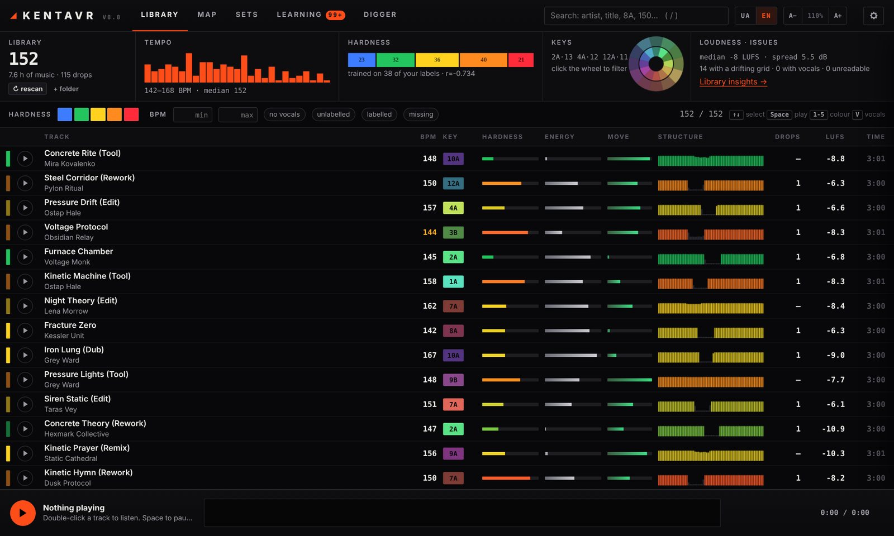

KENTAVR analyses your music library and builds sets from it: which tracks, in what order, where and how to mix. It does not generate audio. Everything runs on your computer and your music is never uploaded.

## What it does

- **Track analysis.** Tempo and grid, Camelot key, drops, 16/32-bar phrases, intro and outro, loudness, vocals, hardness, energy and groove. Serato's grid, BPM and hot cues are read from the file tags.
- **Set generator.** Draw the energy arc or pick one, set the length, BPM and key. You get up to three versions of the set with every transition scored. Lock tracks, swap them, regenerate the rest.
- **Transitions.** For every pair of tracks: the type (LONG BLEND, BASS SWAP, DROP SLAM, ECHO OUT, HARD CUT), the bars out and in, a bar-by-bar mixer plan. Listen to any transition right away.
- **Sound map.** The library laid out by similarity. Select an area and generate a set from those tracks.
- **Learning.** Hardness colours (importable from Serato), drop fixes, transition ratings, recordings of other DJs' mixes. When the program is unsure, it asks.
- **Digger.** A SoundCloud profile, playlist or search: the tracks are analysed like yours and you see what fits your library. The audio is deleted after analysis.
- **Export.** A Serato crate, Rekordbox XML with hot cues on the drops, M3U8, CSV, a tracklist, track numbering in the tags.
- **Interface** in Ukrainian, English, Czech and Russian, 90–150% scale.

| | |
|---|---|
| 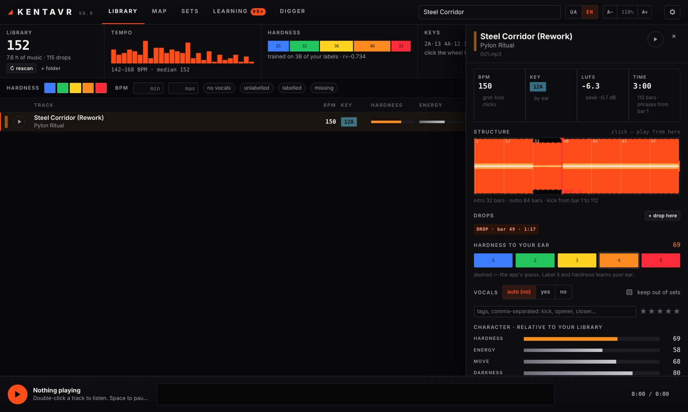 | 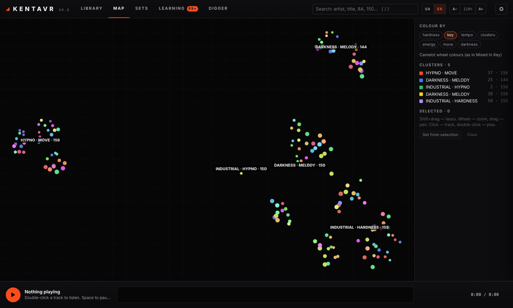 |
| 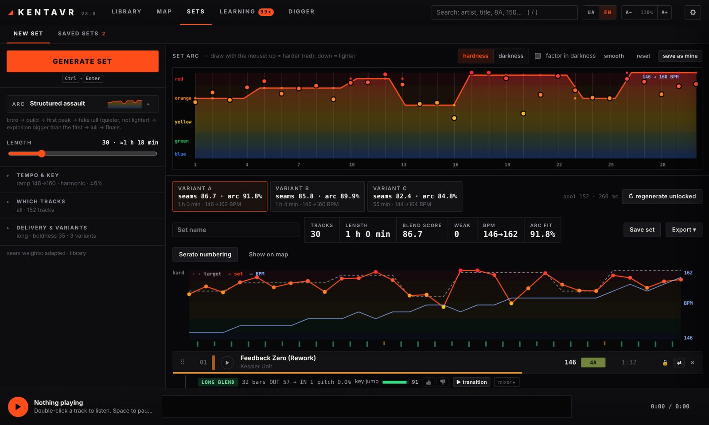 | 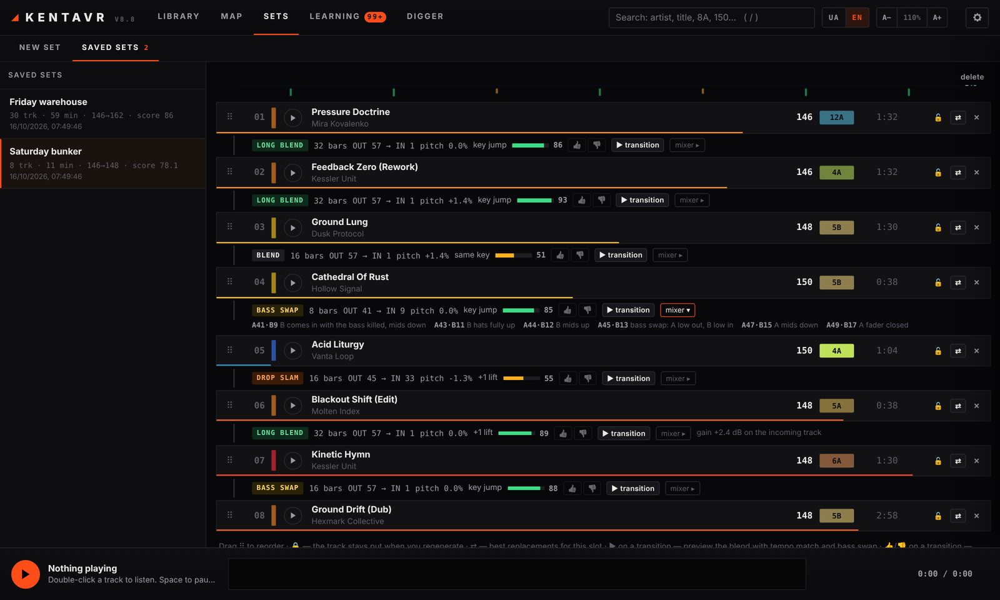 |

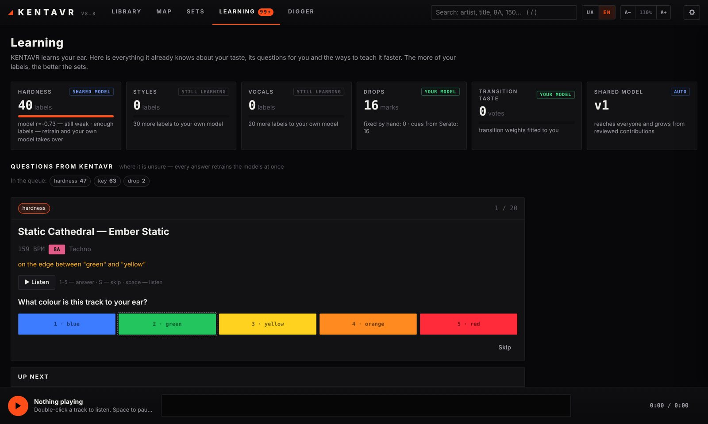

## Install

1. Download [`KENTAVR_Setup.exe`](https://github.com/Hester1337/KENTAVR-PUBLIC/raw/download/KENTAVR_Setup.exe) and run it.
2. Pick **Full** (with the neural nets for a precise grid, the AI ear and vocals) or **Lite**. No admin rights needed.
3. A shortcut appears on the desktop. New versions install with the **Update** button in the program; your library and settings stay.

If Windows says "Windows protected your PC", click "More info" → "Run anyway". The installer is not code-signed yet.

**Needs:** Windows 10 or 11 (64-bit), internet during the install. Full: ~3.5 GB of disk, 8 GB of RAM or more. Lite: ~1.2 GB. An NVIDIA GPU is optional and makes the analysis faster.

## Privacy

- Your music, file names and paths never leave your computer. No account needed.
- At the first start it asks before sending anonymous statistics and labels for the shared model (analysis numbers, no audio). Both switch off in the settings.

---

© Hester1337. Free for personal use. See [LICENSE](LICENSE).
